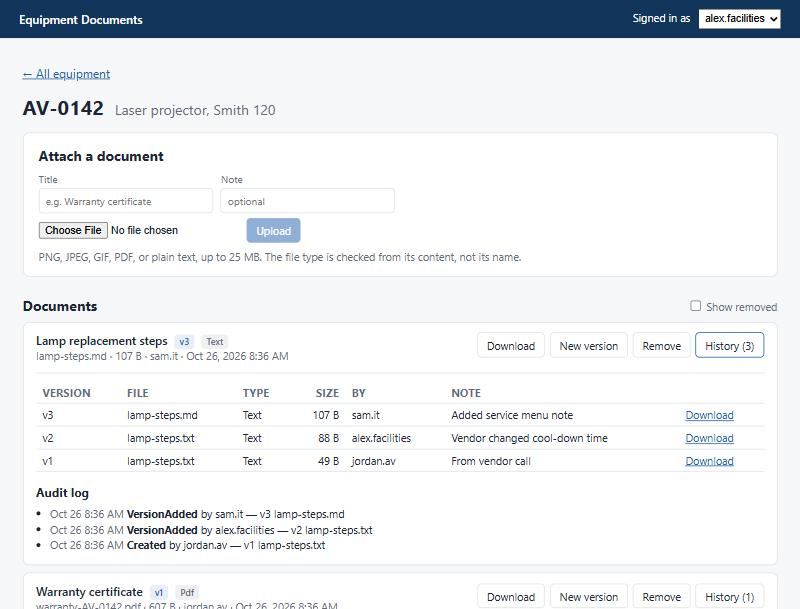

# Versioned document attachments

A Blazor Server app for attaching files to records (here, campus equipment) with version history, safe content checks, soft delete, and a full audit trail. It's a from-scratch rebuild of the kind of document system I designed and built at work: attachments, versioning, and removal across several content types. None of the code or schema comes from that system.



**Skills:** C# / .NET 9, Blazor Server, Entity Framework Core, SQL Server, ASP.NET Core minimal APIs, secure file handling, optimistic concurrency, xUnit (23 tests), application design.

## Run it

Requires the .NET 9 SDK and SQL Server LocalDB.

```bash
dotnet test
dotnet run --project src/VersionedDocuments.Web --launch-profile http -- --reset
```

Open http://localhost:5237. `--reset` recreates the `VersionedDocsDemo` database with sample equipment. Uploaded files go to `src/VersionedDocuments.Web/App_Data` (git-ignored). The "Signed in as" picker stands in for single sign-on.

## Design decisions

### Versions are immutable; the document only points at the current one
A `Document` is the logical thing ("Lamp replacement steps"). Each upload is a new `DocumentVersion` row that is never edited. Old versions stay downloadable, and "who changed what" is answered by the data, not by a log someone has to remember to write.

### Two people uploading at once
Alice opens "New version" on v1. Bob uploads v2 while she's choosing a file. If Alice's upload simply became v3, she'd overwrite Bob's change without ever seeing it. Two layers prevent that:

1. **The UI sends the version the user was looking at.** If it's no longer current, the service refuses with "Someone else uploaded version 2... review it, then upload again."
2. **`CurrentVersionNumber` is an EF Core concurrency token**, so even if both requests pass the check at the same instant, the second `SaveChanges` fails. A unique index on `(DocumentId, VersionNumber)` backs this up in the database itself.

### Never trust the file name or the browser's content type
Both are chosen by the uploader. [`ContentInspector`](src/VersionedDocuments.Core/ContentInspector.cs) reads the first bytes and checks known signatures (PNG, JPEG, GIF, PDF). Text has no signature, so it must have a text extension, decode as valid UTF-8, and contain no NUL bytes. A Windows executable renamed `invoice.pdf` is rejected. Downloads are always served as attachments with the *detected* type, so nothing an uploader sends is ever rendered as a page on the app's own site.

### Stream uploads, don't buffer them
[`DocumentService.StageAsync`](src/VersionedDocuments.Core/DocumentService.cs) streams the upload to a temp file while computing its SHA-256 and enforcing the size limit as bytes arrive. A 2 GB upload fails after 25 MB, not after filling the server's memory. Rejected uploads leave nothing behind (tested).

### Files outside the database, addressed by hash
Content lives in a [blob store](src/VersionedDocuments.Core/BlobStore.cs) keyed by SHA-256. The same file attached to five records is stored once. The database stays small enough to back up quickly, and the storage can move to Azure Blob Storage by implementing one interface.

**Order of writes:** the blob is stored *before* the database row. If the save fails, the leftover is an unreferenced blob, which is harmless. The reverse order could leave a row pointing at a file that doesn't exist.

### Removal is a soft delete with a required reason
"Remove" hides a document and blocks downloads but keeps everything, and it requires a reason that goes into the audit log. Restoring is one click. Permanent deletion is a separate `PurgeAsync` that only touches documents removed before a cutoff, and only deletes a blob when no other version anywhere still uses it. The audit trail survives the purge.

### Every change is audited in the same transaction
Each audit entry is saved in the same `SaveChanges` (or the same transaction, on create) as the change it records. There's no window where a change exists without its audit entry.

### Built for Blazor Server's long-lived circuits
The service creates a short-lived `DbContext` per operation from `IDbContextFactory` instead of holding one for the life of a circuit. That avoids stale tracked entities and the "a second operation was started on this context" error when users click quickly. Downloads use a plain HTTP endpoint instead of the SignalR circuit, so large files stream from disk with range support.

## Tests

`dotnet test` runs 23 tests against SQLite in memory and a temp folder:

- version creation, history, and downloading old versions
- the stale-version check *and* the concurrency token (simulating a race the check can't see)
- deduplication of identical content
- rejection of renamed executables, binary-as-text, oversized and empty files, with no leftovers
- remove/restore, required reasons, purge keeping shared blobs, and the audit trail
- content detection edge cases, including a multi-byte character cut at the header boundary (a bug the tests caught during development)

## What I'd add for production
- Real identity from SSO claims instead of the demo user picker, plus authorization (who may remove or purge).
- Virus scanning on staged files before they're adopted into the store.
- A scheduled purge job and an orphaned-blob sweep.
- Image thumbnails and inline PDF preview.

Built with AI assistance (Claude Code). I set the requirements and design, reviewed the code, and tested every flow in the running app.
